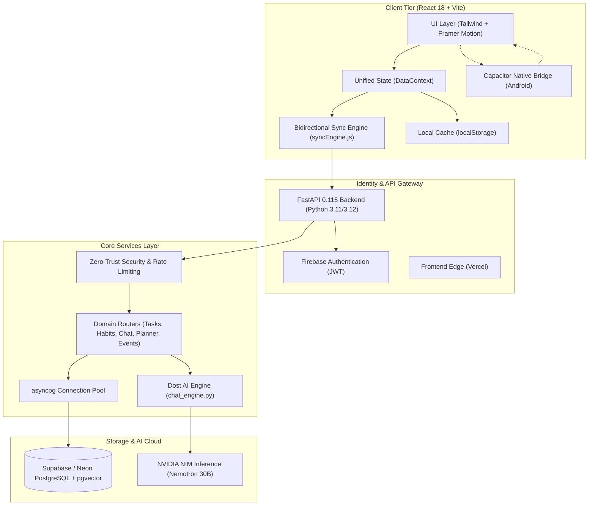

# 🏛️ Mithra Life OS — System Architecture & Design Document

Mithra Life OS is an AI-native personal productivity operating system combining deterministic task management, habit tracking, and journaling with **Dost AI**, a context-aware assistant.

---

## 1. High-Level System Architecture

---

## 2. Core Subsystems

### 2.1 Frontend Architecture (`client-app/client`)
* **Framework:** React 18 with Vite for compilation and HMR.
* **Unified State:** State is centralized in [`DataContext.jsx`](../client-app/client/src/context/DataContext.jsx) (`useData()` hook), providing optimistic state updates, gamification rewards (XP, levels, badges), and persistence across:
  * Tasks & Task Lists
  * Habit Trackers & Streak Calculations
  * Focus Sessions (Pomodoro & Stopwatch)
  * Calendar Events (synced with tasks and habits)
  * Theme & Color Palettes
* **Bidirectional Sync Engine (`syncEngine.js`):**
  * **Optimistic Local-First:** All mutations commit immediately to `localStorage`.
  * **Resilient Queue:** Offline mutations are recorded in a persistent queue. When connectivity restores, operations are executed with exponential backoff and jitter.
  * **Heartbeat Health Checks:** Probes `${API_URL}/ping` every 30 seconds to maintain real-time online/offline status.

### 2.2 Backend Architecture (`client-app/server`)
* **Framework:** FastAPI with fully asynchronous handlers (`async`/`await`).
* **Database Driver:** `asyncpg` with a pooled connection manager (`init_db_pool()`). Prepared statement caching is dynamically adapted based on whether a Transaction Pooler (PgBouncer, port 6543) or direct connection is detected.
* **Security & Multi-Tenancy:**
  * Every request is verified via Firebase Admin JWT credentials (`get_current_user`).
  * All database operations scope records by parameterized `user_id = $1`.
  * Row-Level Security (RLS) is enabled on all tables in Supabase.
* **Rate Limiting:** IP-aware bucket limiter intercepting abusive request spikes across routes (`RateLimitMiddleware`).

### 2.3 Dost AI Engine (`services/ai`)
* **AI Provider:** NVIDIA Inference Microservices (NVIDIA NIM) using an OpenAI-compatible client targeting `nvidia/nemotron-3.5-lightning-30b-a3b`.
* **Dynamic Context Injection:**
  * When a user chats with Dost, `chat_engine.py` inspects the user's live database state to retrieve:
    1. Overdue and pending high-priority tasks.
    2. Daily habits (completed vs pending).
    3. Today's mood score from the journal.
    4. Active calendar events scheduled for today and tomorrow.
* **Deterministic Agentic Actions:**
  * Dost outputs structured JSON actions (`create_task`, `create_habit`, `schedule_event`, `log_mood`) that are parsed client/server-side and executed as verified mutations.
* **Zero-Latency Edge Intent Matcher:**
  * Simple phrases ("good morning", "how are you", "thanks") are resolved client-side via [`dostLocalEngine.js`](../client-app/client/src/services/dostLocalEngine.js) without network calls.
